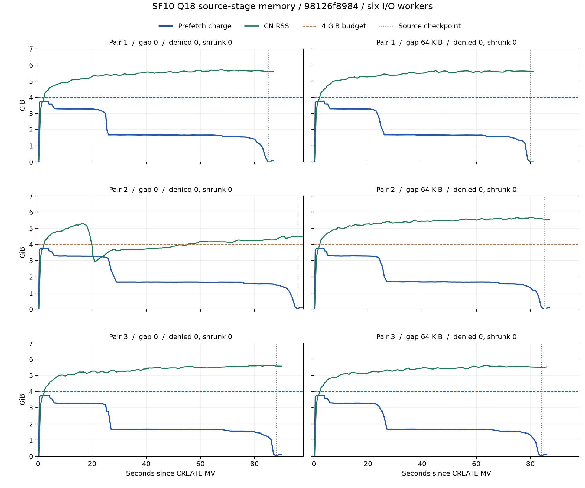

# SF10 Q18 gap matrix after the ColdRanges budget fix

## Findings

All three paired source scans improve with the 64 KiB gap. GET reductions are 7.96%, 4.37% and 12.49%; physical byte increases are 0.53%, 0.13% and 0.71%. Source checkpoints improve by 5.01, 11.00 and 4.00 seconds. Cohort-median physical mean latency decreases from 3.927 to 3.368 ms, while source physical p99/p99.9 stay in the 32/64 ms buckets and caller p99/p99.9 stay in the 378.77/568.15 ms buckets. The consistent result is fewer source GETs and modest source-time improvement in this local MinIO setup; there is no demonstrated tail-latency improvement.

All six runs have zero budget_denied and zero budget_shrunk over the whole query. Sampled charged peaks range from 3.752 to 3.773 GiB, and whole CN RSS peaks range from 5.272 to 5.721 GiB. This removes the observed budget-rejection/per-block fallback at a 4 GiB configuration. Genuine one-block prefetch segments still exist, especially for HashJoin prefixes; their presence is not evidence of budget fallback. No shrink branch was needed here.

CREATE MV differences are -145.22, -67.62 and +131.97 seconds, so these runs do not establish a stable end-to-end gap-policy speedup. In pair 3 the 24-to-22 HashJoin interval increases from 111.00 to 227.00 seconds, CN CPU from 602 to 966 aggregate seconds, and table-38 candidate checks from 44.91M to 194.77M, while aggregate GET service decreases from 49.03 to 43.40 seconds. That interval explains 116 of the 132 added seconds and identifies generated-SST candidate/CPU work as the main observed regression mechanism, rather than slower physical reads. Pair 1 shows the reverse candidate-work difference and a large wall-time gain.

G saturation is observed during startup; none of the later one-second samples reaches G128. Only two post-startup samples across the six runs reach P32. These samples do not exclude short unsampled bursts. The startup admission tail remains and this gap experiment does not fix it.

## Scope and controls

Source is exactly `98126f898412f675ebdd406c35cd273f4972dd2b`, without application patches. All six measurements use the same release executable, SHA-256 `668dda3604d17656f97ad1c0fc2e9821aca92bc6e79d08486520b5c84f8ffcff`. Build uses opt-level 3, application debug assertions off, `split-debuginfo=unpacked`, incremental off and the existing license-crate debug-assertions test configuration. Cargo manifests retain the exact build identity.

Each arm uses `risedev d full` through the shared host-exclusion guard and a new disposable APFS clone of immutable cold seed v1346. There are six LocalityProviders, 53 actors, fixed4 SQL parallelism, 12 advertised CN slots, eight configured streaming runtime workers and six dedicated IO workers. G128/P32/B16, N16, the 1 MiB read cap, 4 GiB prefetch budget, MultiGet, metadata reuse and in-flight reuse are fixed. Source StreamScan, LocalityProvider and HashJoin prefix scans use ColdRanges. Foyer file cache and tracing/profiling are off. The backend is local MinIO.

The workload is the existing locality-backfill Q18 variant with `HAVING sum(l_quantity) > 1` and a 100-row top-N result, not the unmodified TPC-H threshold. Customer has 1.5M rows, orders 15M rows and lineitem 59,986,052 rows; the plan scans lineitem twice, for 136,472,104 snapshot rows. The only compared TOML field is `max_gap_bytes = 0` versus `65536`. The order is 0 / 64 KiB / 64 KiB / 0 / 0 / 64 KiB. Every run validates the same source SST fingerprint, source row counts, SQL and plan hashes, executable, effective settings, worker configuration and the 100-row output oracle. Cold means fresh RW/Foyer process state from the durable seed; host OS page cache is not purged. Intermediate state SSTs are generated during each run and are not frozen.

## Runs and paired differences

| Arm | Source complete midpoint s | Source checkpoint s | MV s | Source GETs | Source GiB | Whole GETs | Whole GiB | Source denied / shrunk | Source budget peak MiB | Source RSS peak MiB | Whole RSS peak MiB |
| --- | ---: | ---: | ---: | ---: | ---: | ---: | ---: | --- | ---: | ---: | ---: |
| p1-gap0 | 84.51 | 85.01 | 679.04 | 42,941 | 12.357 | 123,709 | 36.348 | 0 / 0 | 3841.6 | 5841.1 | 5841.1 |
| p1-gap64k | 79.50 | 80.00 | 533.82 | 39,525 | 12.423 | 123,176 | 36.285 | 0 / 0 | 3857.4 | 5784.1 | 5858.5 |
| p2-gap64k | 84.51 | 85.01 | 690.11 | 40,405 | 12.373 | 121,752 | 36.332 | 0 / 0 | 3863.5 | 5796.3 | 5796.3 |
| p2-gap0 | 95.51 | 96.00 | 757.73 | 42,251 | 12.357 | 123,274 | 36.308 | 0 / 0 | 3847.2 | 5398.5 | 5398.5 |
| p3-gap0 | 87.51 | 88.01 | 506.11 | 44,419 | 12.319 | 127,360 | 36.380 | 0 / 0 | 3849.8 | 5754.9 | 5765.4 |
| p3-gap64k | 83.51 | 84.01 | 638.08 | 38,871 | 12.407 | 119,654 | 36.377 | 0 / 0 | 3853.2 | 5742.1 | 5742.1 |

| Metric (cohort median) | Gap 0 | Gap 64 KiB |
| --- | ---: | ---: |
| Source completion midpoint, s | 87.51 | 83.51 |
| Source checkpoint, s | 88.01 | 84.01 |
| MV wall, s | 679.04 | 638.08 |
| Source GETs | 42,941 | 39,525 |
| Source GiB | 12.357 | 12.407 |
| Whole GETs | 123,709 | 121,752 |
| Whole GiB | 36.348 | 36.332 |
| Source denied | 0 | 0 |
| Source shrunk | 0 | 0 |
| Source charged peak MiB | 3847.2 | 3857.4 |
| Source CN RSS peak MiB | 5754.9 | 5784.1 |
| Whole CN RSS peak MiB | 5765.4 | 5796.3 |
| Source physical mean ms | 3.927 | 3.368 |
| Source physical p99 ms | 32.00 | 32.00 |
| Source physical p99.9 ms | 64.00 | 64.00 |
| Source caller p99 ms | 378.77 | 378.77 |
| Source caller p99.9 ms | 568.15 | 568.15 |
| Source overread MiB | 0.000 | 86.275 |
| Source merged members | 3,099 | 7,017 |
| Source bounded requested MiB | 13319.290 | 13302.547 |

| Pair (64 KiB minus 0) | Source checkpoint s | Source completion midpoint s | MV s | Source GETs | Source MiB | Whole GETs | Whole MiB |
| --- | ---: | ---: | ---: | ---: | ---: | ---: | ---: |
| 1 | -5.01 | -5.00 | -145.22 | -3,416 | +67.407 | -533 | -64.959 |
| 2 | -11.00 | -11.00 | -67.62 | -1,846 | +16.357 | -1,522 | +24.262 |
| 3 | -4.00 | -4.00 | +131.97 | -5,548 | +89.824 | -7,706 | -3.537 |

Percentiles are histogram bucket upper bounds. All RSS/charged peaks are sampled. Each source checkpoint is the first completed full one-second source scrape.

## IO latency and queueing

| Arm | Source physical mean ms | Physical p99 / p99.9 ms | Source caller mean ms | Caller p99 / p99.9 ms | After 5s admission mean / p99 ms | After 5s dispatch mean / p99 ms |
| --- | ---: | ---: | ---: | ---: | ---: | ---: |
| p1-gap0 | 3.440 | 32.00 / 64.00 | 27.499 | 378.77 / 568.15 | 0.0044 / 0.01 | 0.1851 / 5.12 |
| p1-gap64k | 3.368 | 32.00 / 64.00 | 27.979 | 378.77 / 568.15 | 0.0031 / 0.02 | 0.1770 / 5.12 |
| p2-gap64k | 3.559 | 32.00 / 64.00 | 29.105 | 378.77 / 568.15 | 0.0046 / 0.01 | 0.2272 / 5.12 |
| p2-gap0 | 4.815 | 32.00 / 64.00 | 31.762 | 378.77 / 568.15 | 0.0103 / 0.01 | 0.3885 / 10.24 |
| p3-gap0 | 3.927 | 32.00 / 64.00 | 29.524 | 378.77 / 568.15 | 0.0040 / 0.02 | 0.2119 / 5.12 |
| p3-gap64k | 3.337 | 32.00 / 64.00 | 29.701 | 378.77 / 568.15 | 0.0035 / 0.01 | 0.1814 / 5.12 |

Percentiles are histogram upper bucket bounds, not exact quantiles. The caller metric includes prefetch and ordinary ObjectStore callers; it is not a demand-only or iterator-consumption latency metric. The after-five-second columns cover the remainder of the query, not only source scans. Aggregate physical service sums parallel GET durations and is not elapsed query time.

## Prefetch accounting and process memory

The charge is an estimate of live prefetch-owned memory, not a CN RSS cap. The fix reserves direct encoded buffers and one decode peak, actual pinned cache block weights, and independent bounds for concurrently completing cache/singleton results. Smaller prefixes can be attempted before single-block demand fallback. A zero `budget_shrunk` result means that branch was not exercised in this SF10 run; permanent fixed-budget unit tests in the selected commit cover it.

Curves retain startup 0.1-second and later one-second gauge samples. Charged and RSS peaks are sampled. Full source metrics reuse the one-second HTTP scrape; source completion is bracketed by the last incomplete and first complete row-count observation. Every source checkpoint in this matrix precedes the first LocalityProvider startup, so the historical provider-startup checkpoint contamination is absent here.

## Elapsed-time attribution

# Operator-phase attribution

Elapsed differences after source scanning include changes in generated SST candidate work. These counters locate the difference but cannot isolate an end-to-end speedup from the gap policy.

| Arm | Interval | Wall s | CN CPU s | Physical GET service s | GETs | MiB | SST candidates table 38 M | SST candidates table 32 M |
| --- | --- | ---: | ---: | ---: | ---: | ---: | ---: | ---: |
| p1-gap0 | through_source | 85.01 | 378 | 147.73 | 42,941 | 12653.76 | 0.00 | 0.00 |
| p1-gap0 | first_to_24 | 98.01 | 615 | 30.64 | 9,229 | 5538.26 | 0.00 | 0.00 |
| p1-gap0 | 24_to_22 | 232.01 | 1015 | 46.81 | 48,335 | 5406.13 | 195.00 | 0.00 |
| p1-gap0 | 22_to_20 | 170.00 | 754 | 21.84 | 13,838 | 7022.16 | 0.00 | 123.20 |
| p1-gap0 | agg20_to_merge | 91.86 | 312 | 18.59 | 9,212 | 6532.08 | 0.00 | 0.00 |
| p1-gap64k | through_source | 80.00 | 341 | 133.12 | 39,525 | 12721.17 | 0.00 | 0.00 |
| p1-gap64k | first_to_24 | 84.00 | 544 | 33.85 | 10,947 | 5799.91 | 1.03 | 0.00 |
| p1-gap64k | 24_to_22 | 155.00 | 710 | 46.94 | 49,432 | 5280.45 | 119.21 | 0.00 |
| p1-gap64k | 22_to_20 | 132.00 | 590 | 22.06 | 13,603 | 6780.58 | 0.00 | 78.88 |
| p1-gap64k | agg20_to_merge | 80.69 | 294 | 15.69 | 9,661 | 6572.95 | 0.00 | 0.59 |
| p2-gap64k | through_source | 85.01 | 359 | 143.81 | 40,405 | 12670.36 | 0.00 | 0.00 |
| p2-gap64k | first_to_24 | 90.02 | 586 | 37.48 | 11,205 | 5842.63 | 0.42 | 0.00 |
| p2-gap64k | 24_to_22 | 240.99 | 912 | 59.94 | 48,418 | 5147.15 | 194.60 | 0.00 |
| p2-gap64k | 22_to_20 | 151.04 | 646 | 28.45 | 13,623 | 6793.24 | 0.17 | 60.78 |
| p2-gap64k | agg20_to_merge | 120.87 | 328 | 29.61 | 7,999 | 6692.99 | 0.00 | 0.00 |
| p2-gap0 | through_source | 96.00 | 374 | 203.42 | 42,251 | 12654.00 | 0.00 | 0.00 |
| p2-gap0 | first_to_24 | 111.07 | 595 | 59.10 | 12,518 | 5902.82 | 0.60 | 0.00 |
| p2-gap0 | 24_to_22 | 229.00 | 907 | 45.53 | 46,895 | 5135.33 | 194.40 | 0.00 |
| p2-gap0 | 22_to_20 | 207.11 | 671 | 40.09 | 13,795 | 6918.33 | 0.00 | 89.77 |
| p2-gap0 | agg20_to_merge | 113.31 | 339 | 23.17 | 7,794 | 6568.68 | 0.00 | 0.00 |
| p3-gap0 | through_source | 88.01 | 379 | 174.42 | 44,419 | 12614.55 | 0.00 | 0.00 |
| p3-gap0 | first_to_24 | 91.00 | 576 | 46.89 | 12,180 | 5666.88 | 0.00 | 0.00 |
| p3-gap0 | 24_to_22 | 111.00 | 602 | 49.03 | 47,593 | 5442.72 | 44.91 | 0.00 |
| p3-gap0 | 22_to_20 | 133.00 | 604 | 24.55 | 14,287 | 7231.93 | 0.09 | 60.70 |
| p3-gap0 | agg20_to_merge | 82.07 | 289 | 16.26 | 8,881 | 6297.44 | 0.00 | 0.00 |
| p3-gap64k | through_source | 84.01 | 374 | 129.72 | 38,871 | 12704.37 | 0.00 | 0.00 |
| p3-gap64k | first_to_24 | 88.02 | 586 | 46.40 | 12,446 | 5790.80 | 0.23 | 0.00 |
| p3-gap64k | 24_to_22 | 227.00 | 966 | 43.40 | 47,192 | 5330.79 | 194.77 | 0.26 |
| p3-gap64k | 22_to_20 | 135.00 | 622 | 23.51 | 13,789 | 7011.11 | 0.00 | 75.24 |
| p3-gap64k | agg20_to_merge | 102.94 | 326 | 17.73 | 7,336 | 6412.30 | 0.00 | 0.00 |

Physical GET service is an aggregate of parallel reads and cannot be subtracted from wall time. Phase boundaries use provider logs, while counters use the preceding full scrape. SST candidate counters are CN-wide for the named table. Source counters use the first source-complete one-second scrape.

## Historical 312.94 MiB versus 79.91 MiB accounting

This section reads the existing `0bb0df4acf` / 16 GiB gap pair only. It does not rerun that historical workload or mix it into the six-run cohorts.

| Counter | Gap 0 | Gap 64 KiB | Difference |
| --- | ---: | ---: | ---: |
| Physical read MiB | 12586.433013 | 12899.369058 | +312.936045 |
| Declared direct-prefetch MiB | 13237.097849 | 13459.949737 | +222.851888 |
| Explicit scheduler gap MiB | 0.000000 | 79.908559 | +79.908559 |
| Derived remaining MiB | -650.664836 | -640.489238 | +10.175598 |
| physical_gets | 44,532 | 39,504 | -5,028 |
| logical_requests | 47,731 | 46,406 | -1,325 |
| prefetch_direct_segments | 45,680 | 44,537 | -1,143 |
| singleton_registrations | 1,028 | 814 | -214 |
| scheduler_merged_requests | 3,091 | 6,846 | +3,755 |
| scheduler_inflight_reused | 108 | 56 | -52 |

The identity is **312.936045 = 222.851888 + 79.908559 + 10.175598 MiB**. Only 79.908559 MiB is directly counted scheduler gap overread. The 222.851888 MiB term is the change in declared direct-prefetch spans. The remaining 10.175598 MiB is a derived residual combining other reads, overlap/reuse and planning/completion boundaries; it is not an independently measured metadata byte total.

The historical gap64 source checkpoint was at 85.96 s, after the first provider at 83.09 s. Its last full pre-provider scrape was at 80.92 s with 99.50% source rows complete. The final 498 GETs / 197.71 MiB physical and 198.56 MiB declared direct-prefetch bytes mix the source tail with provider startup. The historical source scrape omitted logical requested-byte series, so an exact source-only logical-byte attribution cannot be recovered. Whole-query before/after scrapes retain bounded logical bytes. Raw historical ledger JSON records counts, cancellation/retry outcomes and these coverage limits. The new matrix fixes this sampling omission and checkpoint resolution.

## Evidence and cleanup

`q18-sf10-gap-matrix-98126.json` contains all per-run phase summaries and controls. `q18-sf10-gap-matrix-98126-samples.tar.gz` contains the per-run raw metric snapshots, one-second source samples, memory curves, row progress, host-load and disk samples, logs, plans, configurations, identity/placement checks, and cleanup records. Supporting analysis and runner scripts are retained with the archive. No application code or license source hook is committed by this benchmark report. Owned services and disposable seed clones are removed after each arm; the reusable cold seed and staged release executable are retained.

The historical original [gap0 / 16 GiB samples](q18-sf10-cold-ranges-prefetch16g-samples.tar.gz) and [gap64 samples](q18-sf10-cold-ranges-gap64k-samples.tar.gz) are retained in the same evidence directory.
